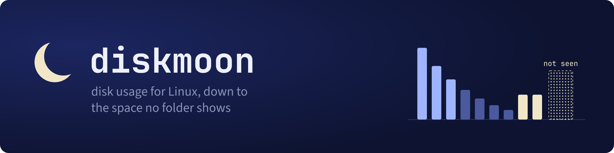
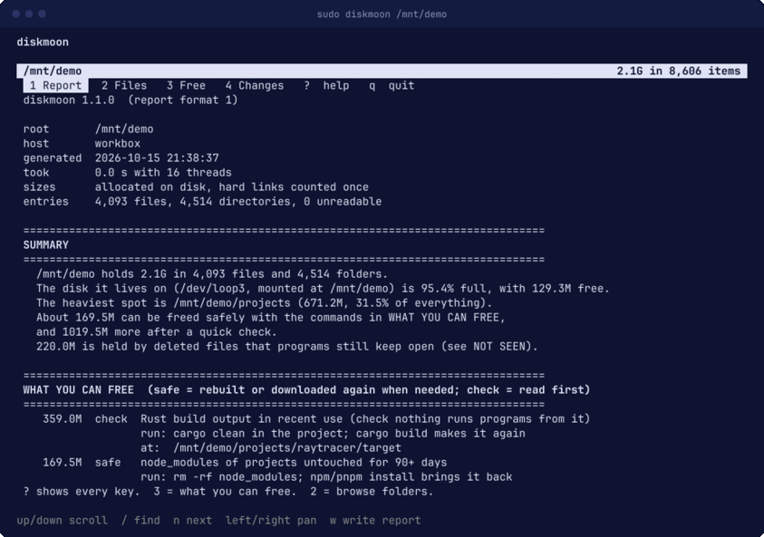
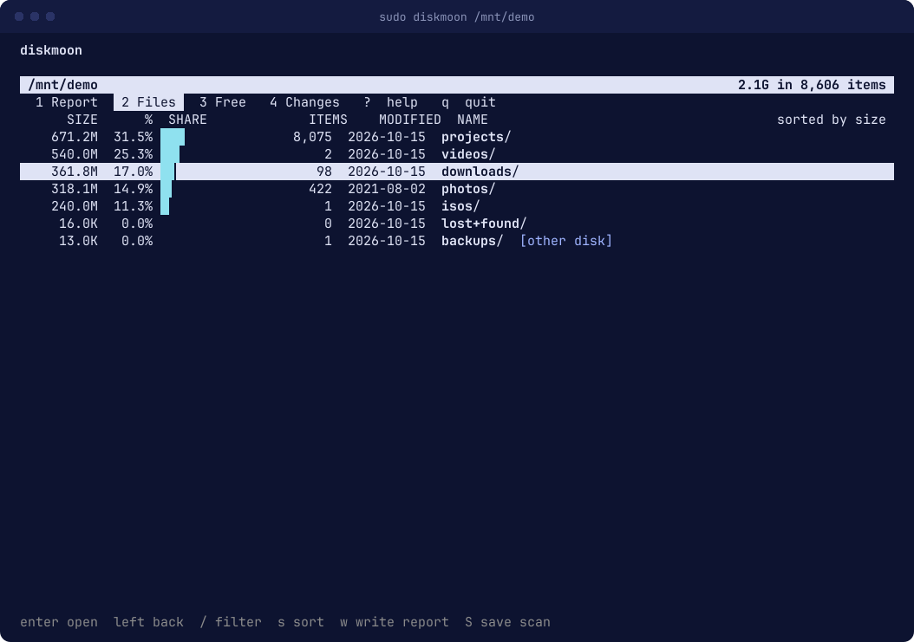
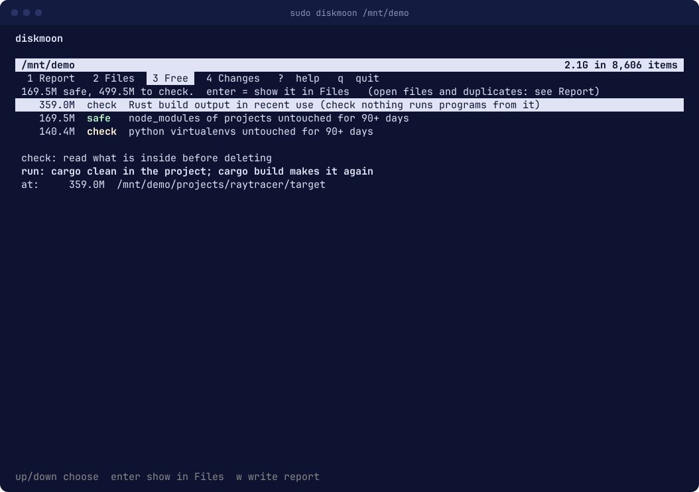
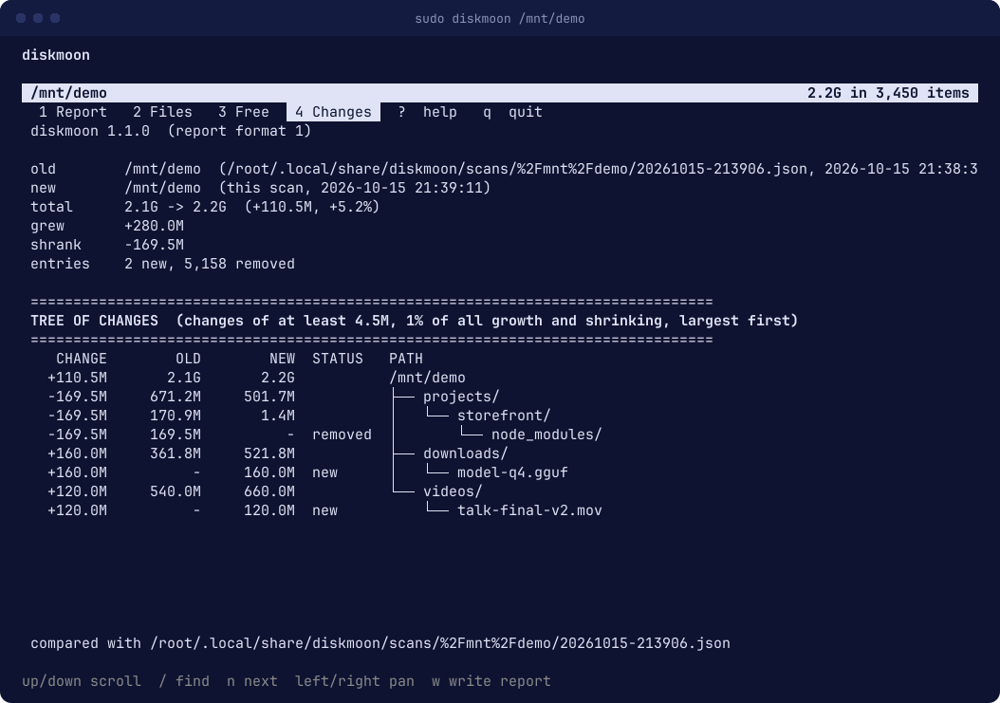
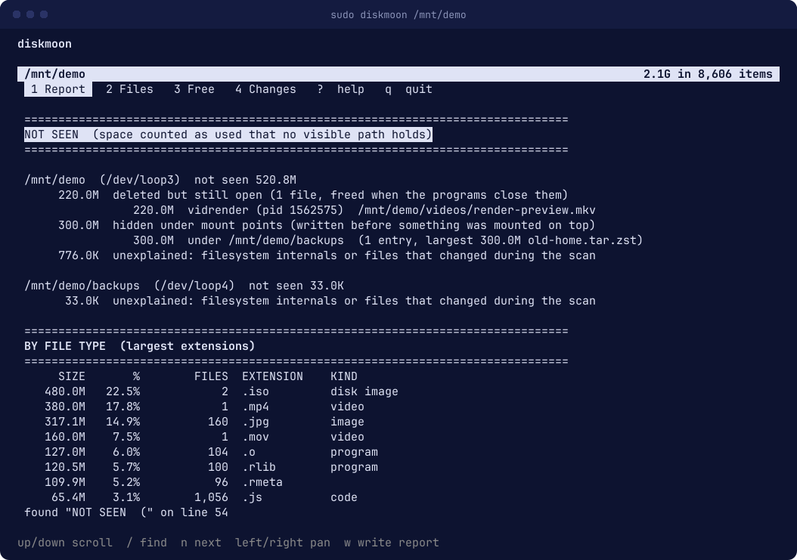
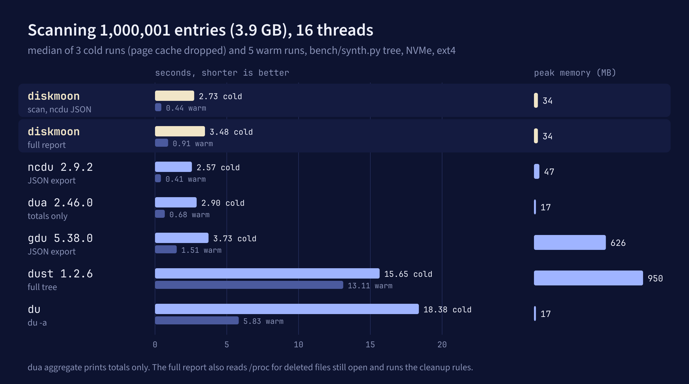

<p align="center"></p>

<p align="center">
  <a href="https://github.com/augustoflorentino/diskmoon/actions/workflows/ci.yml"></a>
  
  
</p>

diskmoon scans a directory tree and tells you where the space went, in plain words. It also
covers the space `du` and ncdu cannot show you: deleted files that a program still keeps open, and
files hidden under a mount point. It matches `du -sxB1` to the byte, uses about 35 bytes of memory
per entry, and only reads. It prints the commands to free space, but you run them yourself.

<p align="center"></p>

```sh
make && sudo make install
diskmoon ~            # interactive view in a terminal
sudo diskmoon /       # whole disk, including what only root can read
diskmoon / -o disk.txt   # the same report as a text file
```

## What the view shows

| | |
|---|---|
|  | **1 Report.** A SUMMARY first: how full the disk is, the heaviest folder, how much can be freed and how much nobody can see. Then WHAT YOU CAN FREE, FILESYSTEMS, CAPACITY, NOT SEEN, BY FILE TYPE, UNTOUCHED FOR OVER A YEAR and the largest files. `/` searches it. |
|  | **2 Files.** Every folder biggest first, with its share of the parent, item count and newest change inside. `/` filters, `s` sorts by size, name, date or count. Other disks mounted inside are marked and kept apart. |
|  | **3 Free.** Package caches, build output, old `node_modules`, virtualenvs and anything marked with `CACHEDIR.TAG`, each with the command its own tool offers. **safe** means it comes back by itself; **check** means read it first. `enter` jumps to the folder. |
|  | **4 Changes.** What grew, shrank, appeared or went away since the last saved scan. Press `S` (or run with `--save`) to save one, and the next run compares against it. |

## The space nobody can see

Your disk says 95% used, but the folders add up to less. diskmoon accounts for the difference
instead of leaving it out:

<p align="center"></p>

- **Deleted but still open.** A log or video was deleted while a program kept it open, so the
  space stays used until that program closes it. diskmoon finds these files through `/proc/*/fd`
  and `/proc/*/map_files` and names the program and its pid.
- **Hidden under mount points.** Files written into a folder before a disk was mounted on top of
  it. As root, diskmoon looks under each mount point through a private bind mount, which leaves
  your mounts as they are.
- **Unexplained.** Whatever is left: filesystem metadata, or files that changed during the scan.
  Normally it is a few kilobytes.

## Speed and memory

<p align="center"></p>

On a tree of a million files, scanning and exporting ncdu JSON takes about as long as ncdu
itself, cold or warm. diskmoon uses less CPU, 28% less memory than ncdu and about 18 times less
than gdu. The full report costs about half a second more on a warm cache, mostly to read `/proc`
for deleted files that are still open. That cost depends on how many processes are running, not on
the size of the tree. To repeat the measurement on your machine:

```sh
python3 bench/synth.py /tmp/tree          # same tree for the same seed, 1M entries, 3.9 GB
python3 bench/bench.py /tmp/tree -n 5
sudo python3 bench/bench.py /tmp/tree -n 3 --cold
```

## Accuracy

- The total is exactly what `du -sxB1` reports, checked on ext4, xfs and btrfs. A hard link counts
  once, under the same path whether the scan uses 1 thread or 32.
- On btrfs, subvolumes and snapshots count as part of their disk. When reflinked copies make the
  files add up to more than the disk uses, a note in the report says why.
- Names keep valid UTF-8; invalid bytes and control characters are written as `\xNN`. Paths
  longer than `PATH_MAX` are still read, one directory descriptor at a time.
- The tests run under ASan, UBSan and LSan (`make check-sanitize`), and CI also runs them under
  TSan.

## Other ways to use it

```sh
diskmoon /srv -o srv.json            # ncdu JSON export; ncdu -f srv.json opens it too
diskmoon -f srv.json                 # report from an export, without scanning again
diskmoon /srv -F csv -o - | head     # one CSV row per entry
diskmoon /data --save                # keep this scan in ~/.local/share/diskmoon/scans
diskmoon /data -c last               # tree of what changed since then
diskmoon ~ --duplicates=10M          # files with the same content, 10M and up
```

`-d` limits the depth of the tree, `-m 100M` folds small entries, `-n` sets how many large files
to list, `-a` counts file length instead of blocks, and `-x` stays on one filesystem. `man diskmoon`
documents every option and each section of the report.

## Build

Linux with glibc, a C11 compiler and Python 3 for the tests. The interactive view uses
[c-tuikit](https://github.com/augustoflorentino/c-tuikit), included as a single header in
`third_party/`, so nothing else needs to be installed.

```sh
make                       # ./diskmoon
make check                 # end-to-end tests on generated trees
make install PREFIX=/usr   # binary and man page
make dist                  # release tarball, used by packaging/aur/PKGBUILD
```

`INDEX.txt` says what each source file does. Changes are listed in [CHANGELOG.md](CHANGELOG.md),
and security reports go through [SECURITY.md](SECURITY.md).

## License

MIT, see [LICENSE](LICENSE). c-tuikit is MIT too, see `third_party/c-tuikit/LICENSE`.
